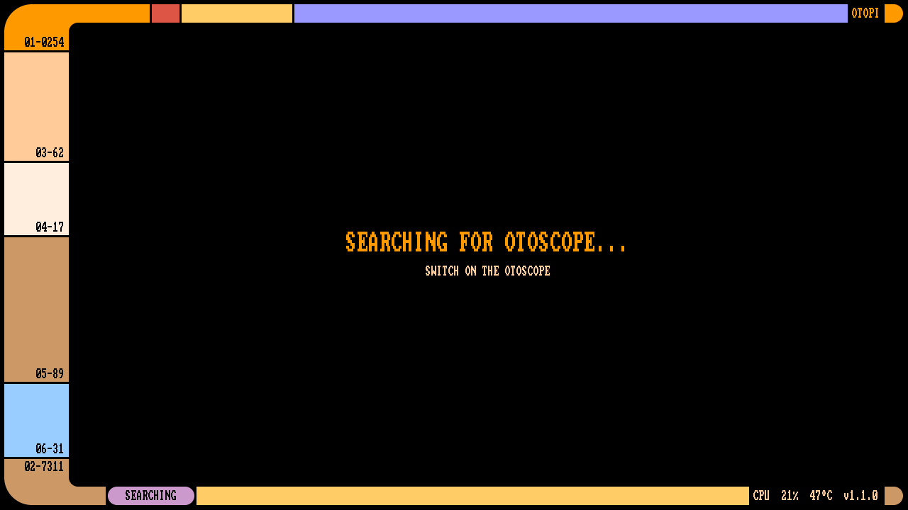

# otopi



otopi turns a Raspberry Pi Zero W and an HDMI screen into a viewer for the NE3 WiFi
otoscope (ear camera). It boots from an SD card, connects to the otoscope's WiFi and
shows the live video on the screen. The picture is kept level using the otoscope's tilt
sensor.

## What you need

- Raspberry Pi Zero W
- microSD card
- Mini-HDMI to HDMI cable or adapter, and a monitor
- Micro-USB power supply
- NE3 WiFi otoscope

## Flashing

1. Download `otopi-<version>-sdcard.img.xz` from the
   [latest release](https://github.com/allgoewer/otopi/releases/latest).
2. Write it to the microSD card with

   ```sh
   xzcat otopi-*-sdcard.img.xz | sudo dd of=/dev/sdX bs=4M conv=fsync
   ```

3. Put the card into the Pi, connect the screen and the power supply.
4. Switch on the otoscope. The video starts once the Pi has connected.

## Configuration

The SD card has a FAT partition named `OTOPI` containing `otopi.conf`. Edit it with any
text editor, either with the card in your computer, or with the card in the Pi and the
Pi's `USB` port (not `PWR`) connected to your computer, where it shows up as a USB drive.
Eject the drive before unplugging the Pi. Changes take effect at the next boot.

| Setting | Value | Meaning |
| --- | --- | --- |
| `rotate` | `snap` (default) | Keep the picture level, snapping to 0°, 90°, 180° or 270° within about 8°. |
| | `free` | Keep the picture level at any angle. |
| | `off` | Never rotate the picture. |

Example:

```
rotate = off
```

The drive also contains a `README.md` describing its files and SSH login.

See [doc/troubleshooting.md](doc/troubleshooting.md) if something does not work, and
[doc/development.md](doc/development.md) for building from source.
